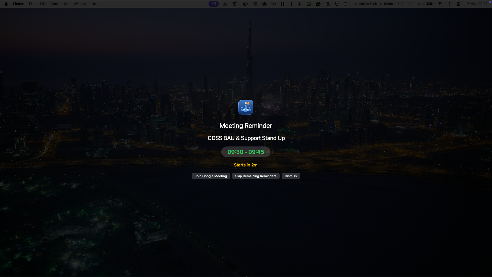

# FullscreenReminder

A macOS menu bar application that reminds you about upcoming meetings from your calendar. It's designed to grab your attention by showing a full-screen reminder, ensuring you never miss a meeting again.

## Features

- **Menu Bar Integration:** See your next meeting at a glance in the menu bar.
- **Full-Screen Reminders:** Get intrusive, full-screen reminders for your meetings.
- **Customizable Reminder Times:** Choose how far in advance you want to be reminded.
- **Calendar Integration:** Works with the macOS Calendar app and any calendars you have connected to it.
- **Meeting Details:** Quickly see the title, time, and a link to join the meeting.

## Demo



## Resetting Preferences

If you want to simulate a first-time launch or clear saved settings, quit the app and run:

```bash
defaults delete com.lars.FullscreenReminder
tccutil reset Calendar com.lars.FullscreenReminder
```

The first command clears all user defaults (reminder lead times, sound, calendar selection, etc.). The second removes Calendar permissions so macOS prompts again the next time you run the app.

## Building

```shell
Usage: ./build.sh [options]

Builds FullscreenReminder using 'swift build', assembles the .app bundle, signs it, and packages it into the dist/ directory.

Options:
  -h, --help                Show this help message and exit

Environment Variables:
  BUMP_BUILD=1              Auto-increment the build number (CFBundleVersion)
  BUMP_MARKETING_VERSION=1  Auto-increment the marketing version (CFBundleShortVersionString)
  NEW_MARKETING_VERSION=X.Y.Z
                            Set a specific marketing version
  CREATE_DMG=1              Create a DMG installer in addition to the ZIP
  SKIP_CODESIGN=1           Skip the codesigning and verification steps
  CODESIGN_IDENTITY="..."   Override the default codesigning identity
```

```shell
./build.sh
killall FullscreenReminder
cp -r "dist/FullscreenReminder.app" /Applications
open "/Applications/FullscreenReminder.app"
```

## Releases (GitHub Actions)

`.github/workflows/build.yml` builds a universal app on every push, signs it with the Developer ID certificate, notarizes and staples it, and packages a ZIP and a DMG.

- **Push to `main`:** the files replace those on the [`latest`](../../releases/tag/latest) pre-release (version `1.1.<run number>`).
- **Push a tag `vX.Y.Z`:** a release `FullscreenReminder X.Y.Z` is created with the files:

  ```shell
  git tag v1.2.0 && git push origin v1.2.0
  ```

- **Pull requests / manual runs:** build only; the files are attached to the run as an artifact.

### In-app updates (Sparkle)

The app updates itself with [Sparkle](https://sparkle-project.org). Each build from `main` signs its ZIP with the Sparkle EdDSA key and publishes `appcast.xml` on the `latest` release; the app reads it from `SUFeedURL` in `Resources/Info.plist`, checks daily, and offers the update (or installs it, if "Automatically install updates" is on in Settings). Sparkle compares `CFBundleVersion`, which CI sets to the run number, so every new build from `main` is newer. Tagged `v*` releases are not in the feed.

The private key is the `SPARKLE_PRIVATE_KEY` secret and is also in the login keychain of the Mac that made it (account `fullscreenreminder`). Its public half is `SUPublicEDKey` in `Info.plist`; if the key is ever replaced, installed copies reject updates until they are reinstalled by hand. Export the key with:

```shell
.build/artifacts/sparkle/Sparkle/bin/generate_keys --account fullscreenreminder -x sparkle.key
```

Signing uses these repository secrets: `APPLE_CERTIFICATE` (base64 .p12), `APPLE_CERTIFICATE_PASSWORD`, `APPLE_SIGNING_IDENTITY`, `APPLE_API_KEY` (key ID), `APPLE_API_ISSUER`, `APPLE_API_PRIVATE_KEY` (contents of the .p8) and `SPARKLE_PRIVATE_KEY` (see above). Without them the app is signed ad-hoc and not notarized.

To notarize a local build, store a notarytool profile once (`xcrun notarytool store-credentials <profile>`) and run:

```shell
NOTARIZE=1 NOTARY_PROFILE=<profile> CREATE_DMG=1 ./build.sh
```
